# Real-Time Multi-Room Trivia Tournament

Kahoot-style live trivia. Hosts build quizzes and open a lobby; players join with a six-character
code (no account needed); the server pushes timed multiple-choice questions to everyone over
WebSockets, scores answers atomically and shows a live leaderboard and podium. Finished games are
kept as history, with a results page and a CSV export.

**Stack:** Django 6 + DRF + SimpleJWT + Channels (Daphne) + Redis + Postgres | React 18 +
TypeScript (strict) + Vite + Zustand + Axios

## Features

| Area           | What it does                                                                                                   |
| -------------- | -------------------------------------------------------------------------------------------------------------- |
| Accounts       | Register as host or player, JWT login with silent refresh, host-only endpoints                                 |
| Quiz authoring | Nested quiz/question/choice editor, tags, search, pagination, per-question time limit and points               |
| Lobbies        | Unique join codes, guests join with a nickname, lock the lobby, kick a player                                  |
| Rooms          | One Redis group per game: events never cross from one game to another                                          |
| Live play      | Server-owned timer, countdown driven by the server's timestamp, one answer per question                        |
| Scoring        | `transaction.atomic` + `select_for_update` + `F()`; faster correct answers earn more                           |
| Leaderboard    | Live standings after every question, podium at the end                                                         |
| Resilience     | Socket reconnect with backoff and state restore, toasts, error boundary, timer re-armed after a server restart |
| History        | Finished games, per-question results, CSV export (one row per player per question)                             |
| Accessibility  | Skip link, page titles and focus on navigation, labelled forms, live regions, keyboard-only play               |

## Screenshots

### Hosting

| Quizzes | Quiz editor |
| ------- | ----------- |
| 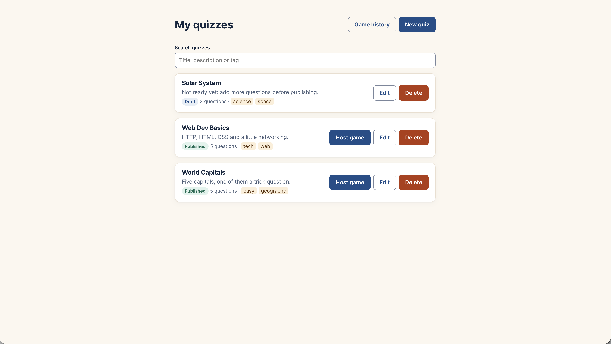 | 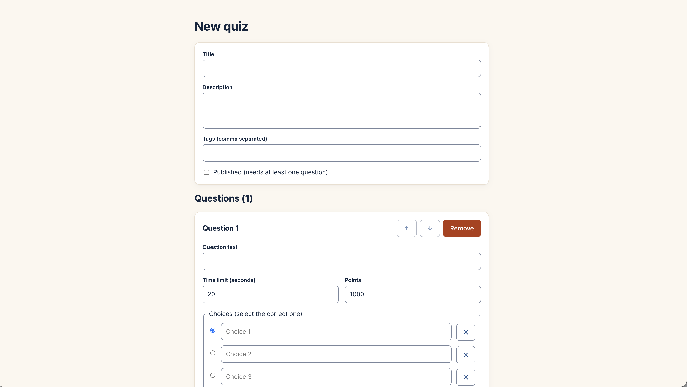 |

| Lobby, waiting for players | Lobby with a player (kick, lock, start) |
| -------------------------- | --------------------------------------- |
| 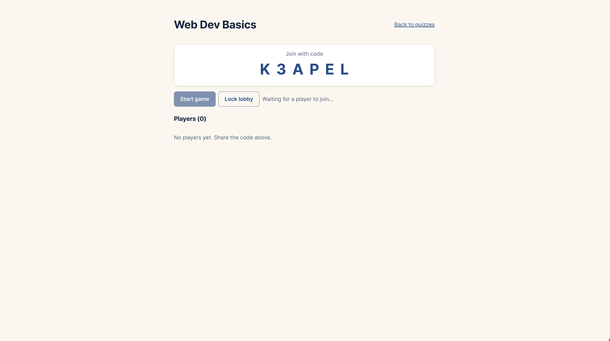 | 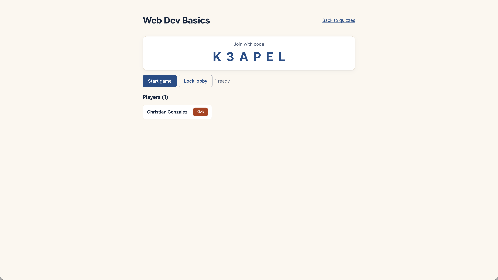 |

### Playing

| Join a game | Waiting for the host |
| ----------- | -------------------- |
| 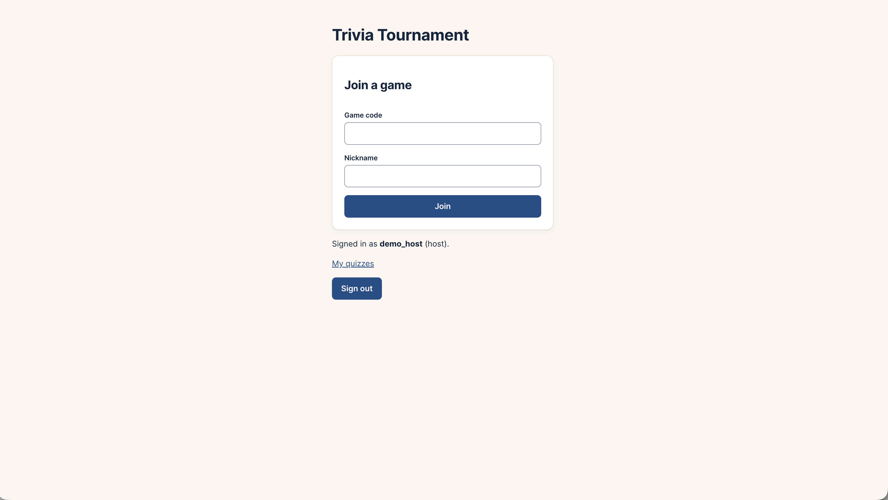 | 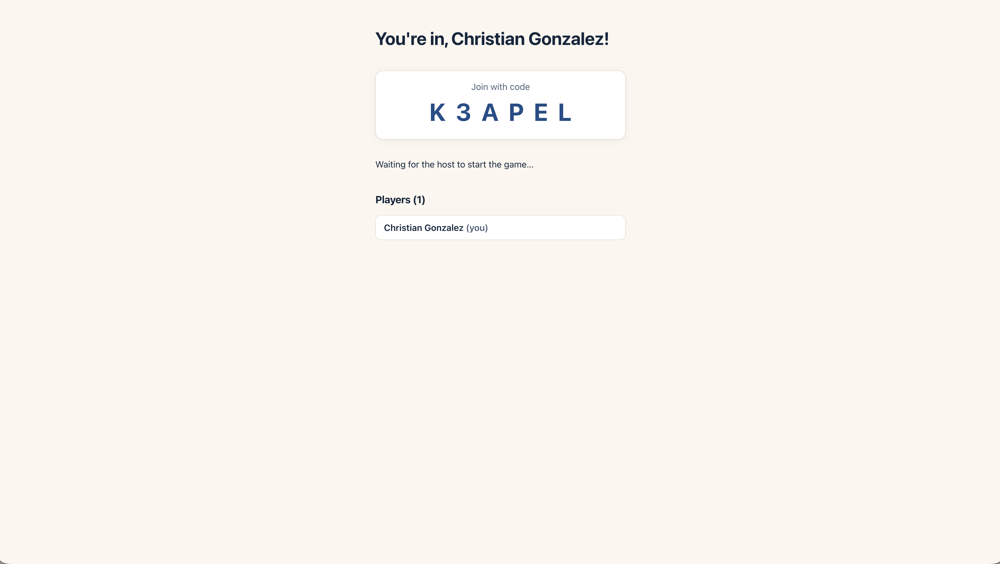 |

| Live question | Answer reveal and standings |
| ------------- | --------------------------- |
| 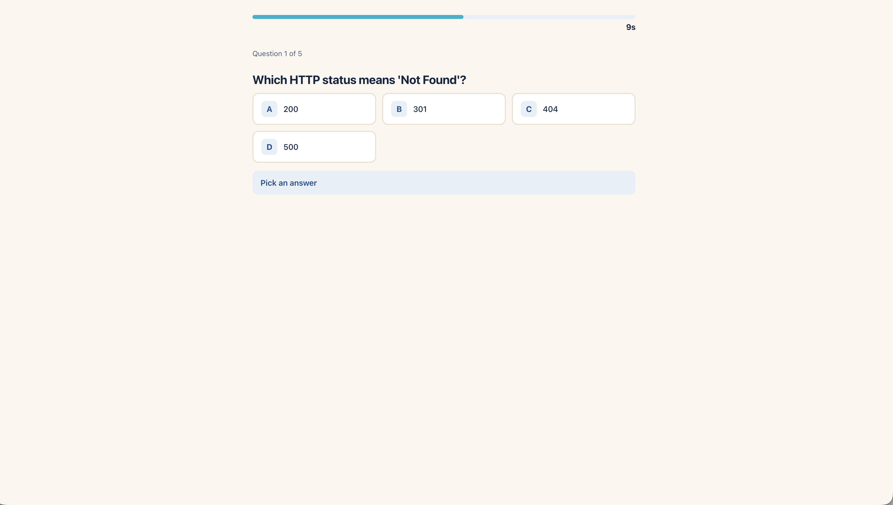 | 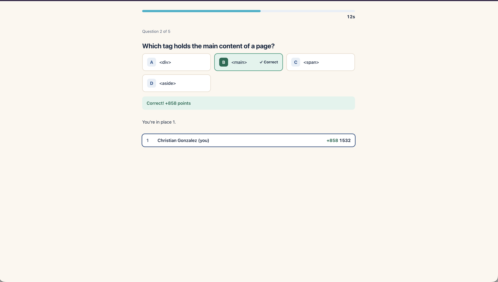 |

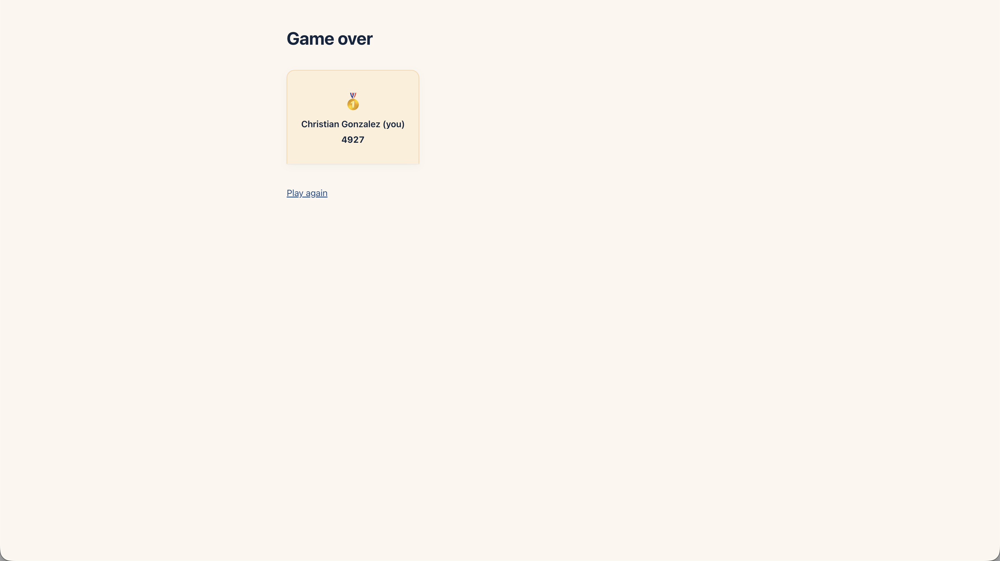

### History

| Game history | Results for one game |
| ------------ | -------------------- |
| 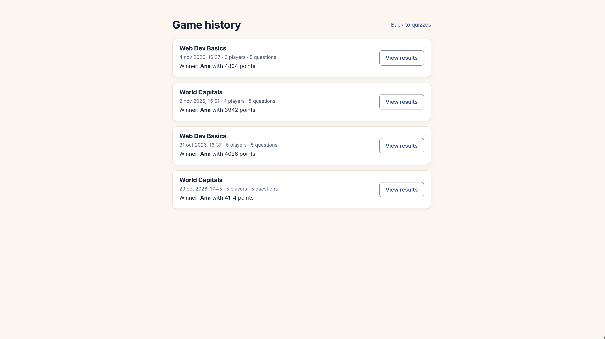 | 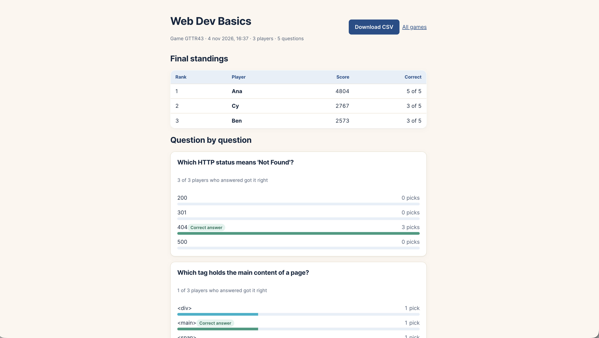 |

## Layout

```txt
backend/    Django project (config/, apps/accounts, apps/quizzes, apps/games)
frontend/   React + TS app (Vite); src/api = every network call, src/store = Zustand
docs/       ARCHITECTURE.md (data model, WS protocol, resilience), DEMO.md (demo script),
            screenshots/ (images used in this README)
docker-compose.yml   Postgres + Redis for local development
```

## Quick start

You need Docker, Python 3.12 or newer (Django 6), and Node 20 or newer.

```bash
cp .env.example .env
docker compose up -d            # Postgres + Redis

# Backend
cd backend
python -m venv .venv && source .venv/bin/activate
pip install -r requirements.txt
python manage.py migrate
python manage.py seed_demo      # optional: demo accounts, quizzes and finished games
python manage.py runserver      # Daphne serves HTTP + WebSockets on :8000

# Frontend (new terminal)
cd frontend
cp .env.example .env
npm install
npm run dev                     # http://localhost:5173
```

Run **one** Daphne process. The game timers and per-player socket counts live in that process's
memory (see `docs/ARCHITECTURE.md`). After a restart, the first socket that reconnects to a running
game re-arms its timer from the database.

### Demo data

`python manage.py seed_demo` creates two accounts (password `trivia-demo-123`):

| Account       | Role   | Has                                                                 |
| ------------- | ------ | ------------------------------------------------------------------- |
| `demo_host`   | host   | 2 published quizzes, 1 draft, 4 finished games with players/answers |
| `demo_player` | player | nothing: a ready-made account to play with                          |

It does nothing if the data is already there. `python manage.py seed_demo --reset` deletes the two
demo accounts (and what they own) and rebuilds them; other accounts are never touched. The seeded
standings are the same on every run.

Step-by-step demo script: [`docs/DEMO.md`](docs/DEMO.md).

## Checks

```bash
# Backend (needs the Postgres from docker compose; tests use an in-memory Channels layer)
cd backend && ruff check . && pytest

# Frontend
cd frontend && npm run typecheck && npm run lint && npm test
```

- Backend tests cover auth and roles, quiz validation and query counts, the lobby consumer, a full
  five-question game, atomic scoring under concurrent answers, reconnect and restore, history,
  CSV export, the error envelope, and the seed command.
- Frontend tests (Vitest + Testing Library) cover the stores, the countdown, the socket hook
  (reconnect, backoff, heartbeat, refusal codes) with a fake WebSocket, the API client's error and
  token-refresh handling, and the main components and pages.
- The concurrency tests in `apps/games/tests/test_scoring.py` use real threads and need Postgres.

## Configuration

`.env` (backend, repo root) and `frontend/.env` are never committed; `.env.example` and
`frontend/.env.example` list every variable.

| Variable                                                                            | Meaning                                          |
| ----------------------------------------------------------------------------------- | ------------------------------------------------ |
| `DJANGO_SECRET_KEY`, `DJANGO_DEBUG`, `DJANGO_ALLOWED_HOSTS`, `CORS_ALLOWED_ORIGINS` | Django basics                                    |
| `POSTGRES_*`                                                                        | Database connection                              |
| `REDIS_URL`                                                                         | Channels layer                                   |
| `JWT_ACCESS_MINUTES`, `JWT_REFRESH_DAYS`                                            | Token lifetimes                                  |
| `TRIVIA_REVEAL_SECONDS`                                                             | Pause that shows the results between questions   |
| `VITE_API_URL`, `VITE_WS_URL`                                                       | Where the frontend finds the API and the sockets |

## Troubleshooting

- **`Timeout reading from localhost:6379`**: Redis isn't running (`docker compose up -d`).
- **Pages load but nothing updates live**: check `VITE_WS_URL` and that the backend runs under
  Daphne (`runserver` does, because `daphne` is first in `INSTALLED_APPS`).
- **A game freezes after you restart the backend**: reload the host or a player page; the first
  reconnecting socket restarts the game's timer.
